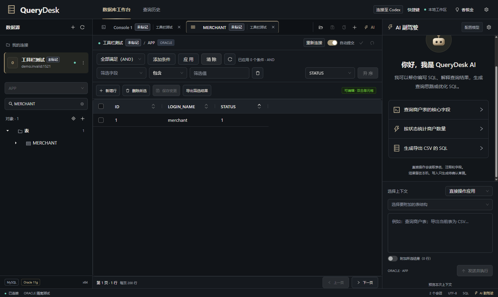

# QueryDesk

Windows 中文数据库工作台，支持 **MySQL、Oracle、SQL 多标签编辑、数据筛选和排序、表格编辑、结构设计、AI SQL 副驾驶与 Codex MCP 接入**。

当前公开版本：**0.3.12 · 2026-10-27 · Windows x64**。

[下载安装包](https://github.com/zjpCoder/QueryDesk/releases/tag/v0.3.12-20261027) · [详细使用手册](docs/USER_GUIDE.md) · [开发与打包](docs/DEVELOPMENT.md) · [Codex / MCP 配置](docs/MCP.md) · [问题反馈](https://github.com/zjpCoder/QueryDesk/issues)



## 下载与安装

1. 打开 [Releases](https://github.com/zjpCoder/QueryDesk/releases)，下载 `QueryDesk-0.3.12-20261027-x64-Setup.exe`。
2. 退出旧版 QueryDesk，双击安装包，按向导选择安装目录。
3. 从桌面或开始菜单打开 QueryDesk，新建数据库连接。

安装包约 **125 MiB**，已包含 Electron、Java 运行时和 JDBC 驱动。普通使用无需额外安装 Node.js、JDK 或 Oracle Instant Client；连接数据库仍需要对应网络及数据库账号。AI 功能需要自行配置兼容接口。

下载页同时提供 `SHA256SUMS.txt`。在 PowerShell 中校验安装包：

```powershell
Get-FileHash .\QueryDesk-0.3.12-20261027-x64-Setup.exe -Algorithm SHA256
```

## 主要能力

| 能力 | 说明 |
| --- | --- |
| 数据库连接 | MySQL、Oracle Service Name / SID；连接环境标记、只读设置 |
| SQL 编辑器 | 多标签、语法高亮、补全、格式化、参数绑定、错误定位、SQL 文件和草稿恢复 |
| 对象树 | 按类型分组、搜索、虚拟滚动、定位当前表、查看表和程序对象定义 |
| 数据浏览 | 多条件 AND / OR 筛选、服务端分页、排序字段及方向、列头排序 |
| 表格操作 | 复制完整字段名、悬浮查看注释和类型、暂存新增 / 修改 / 删除、确认保存 |
| 事务 | 自动提交、手动提交 / 回滚、每个标签独立会话 |
| 结构设计 | 字段、主键、索引、外键、注释；先预览 DDL 再执行 |
| 导出 | CSV / JSON、按筛选导出、整表导出、完整查询结果导出、进度与取消 |
| AI 副驾驶 | 生成、解释、修复、优化 SQL；预览上下文；只读查询操作与导出 |
| Codex 接入 | 一键配置本机 MCP，供 Codex 访问已保存的数据库连接 |
| 外观 | 经典紫、清透紫、香槟金 |

## 五分钟上手

### 1. 建立连接

点击左侧连接区的 `+`，选择数据库类型，填写主机、端口和账号密码；Oracle 另选 Service Name 或 SID。测试连接成功后保存，再点击连接建立会话。

可以标记“开发 / 测试 / 生产”环境。需要限制写入时，启用“只读连接”。环境标记用于识别连接；真正的数据库权限仍由账号权限决定。

### 2. 执行 SQL

```sql
-- MySQL
SELECT NOW() AS current_time;

-- Oracle
SELECT SYSDATE AS CURRENT_TIME FROM DUAL;
```

将光标放在语句中，按 `Ctrl+Enter` 执行当前语句；选中一段 SQL 后使用同一快捷键执行选区。先确认当前标签的连接和 Schema。

### 3. 浏览、筛选和排序

双击左侧表或视图。选择“筛选字段 → 条件 → 筛选值”，点击“应用”。可添加多个条件，并选择全部满足或任一满足。

筛选区右侧的“排序字段”用于对全部匹配数据排序，支持升序 / 降序及清除排序；点击列头右侧排序图标也可以切换。分页时保留已应用的筛选和排序。点击字段名称复制完整字段名，悬浮查看字段说明。

### 4. 修改数据

可编辑表中双击单元格修改，使用“新增行”“删除所选”暂存行变更，点击“保存变更”后确认写入。自动提交开启时保存即提交；关闭自动提交后，需要继续点击提交或回滚。

无主键、只读连接、视图或不满足编辑条件的表会显示只读原因。

### 5. 使用 AI

打开右侧 AI 设置，填写兼容 Chat Completions 的 API 地址、模型和密钥。直接操作模式需要模型支持工具调用；也可以选择仅生成、解释、修复或优化 SQL。

发送前查看上下文预览。AI 直接操作中的查询使用独立只读会话；修改数据或结构的请求会生成 SQL 草稿，由用户检查后执行。**MCP 工具是另一条调用通道，包含写入及 DDL 能力，详见 [MCP 说明](docs/MCP.md)。**

## 常用快捷键

| 快捷键 | 用途 |
| --- | --- |
| `Ctrl+Enter` | 编辑器执行当前语句 / 选区；表格中保存变更 |
| `Ctrl+F2` | 停止当前操作 |
| `Ctrl+Space` | SQL 补全 |
| `Ctrl+Alt+L` | 格式化 SQL |
| `Ctrl+O` / `Ctrl+S` / `Ctrl+Shift+S` | 打开 / 保存 / 另存为 SQL 文件 |
| `Ctrl+B` | 在编辑器打开表定义 |
| `Ctrl+F5` | 刷新当前对象或数据 |
| `Alt+Insert` / `Alt+Delete` | 表格新增 / 暂存删除 |
| `Ctrl+N` / `Ctrl+Shift+A` | 搜索数据库对象 / 查找操作 |
| `Ctrl+Alt+E` | 查询历史 |

完整说明可在应用右上角“快捷键”和 [使用手册](docs/USER_GUIDE.md) 中查看。

## 源码与当前安装版的对应关系

这个仓库同时保留三类文件：

- `src/`、`electron/`、`java/`：原始 0.3.12 TypeScript / React / Java 工程。
- `maintenance/`：安装版后续修改所用的补丁源码、模块和验证脚本。
- `runtime-snapshot/`：从本次安装版提取、逐文件校验的发布代码快照，包含当前界面和后端修改。

**后续修改尚未全部回移到原始 TypeScript 文件。** `npm run dev` / `npm run build` 构建原始工程；`npm run build:release` / `npm run dist:release` 使用当前发布快照，保留这次安装版的实际行为。快照中的前端文件是已编译代码，不能当作未经编译的 React 源文件。详细边界和命令见 [开发文档](docs/DEVELOPMENT.md)。

```powershell
git clone https://github.com/zjpCoder/QueryDesk.git
cd QueryDesk
npm ci
npm run setup:jdbc
npm run verify:snapshot
npm run build:release
npm run start:release
```

从源码构建需要 Windows x64、Node.js 22.12+ 或 24，以及 JDK 17 / 21；成品安装用户不需要这些开发工具。

## 本地数据与边界

- 连接配置保存在 `%APPDATA%\querydesk\settings.json`，SQL 工作区保存在 `workspace.enc`；密码和密钥使用当前 Windows 用户的 `safeStorage` 加密。
- SQL 草稿恢复不恢复数据库事务，也不会自动重跑 SQL。完整查询结果不随草稿恢复。
- 查询结果默认保留在本机；启用 AI 后，所选 SQL、结构、错误及主动附加的结果会按上下文预览发送到配置的模型服务。
- Git 仓库和源码包不包含本机连接设置、工作区、数据库导出、用户日志、账号密码或 API 密钥。
- 当前版本不提供 SSH 隧道、云同步、自动更新、结构对比、迁移管理或批量导入。

## 文档与许可

- [详细使用手册](docs/USER_GUIDE.md)：连接、编辑器、数据操作、事务、导出、AI、排错。
- [MCP 配置](docs/MCP.md)：一键接入、手动配置、工具能力与连接问题。
- [开发与构建](docs/DEVELOPMENT.md)：目录结构、原工程与快照、测试、打包、复现范围。
- [发布记录](CHANGELOG.md)：本次公开版本的变更。
- [历史原工程说明](docs/archive/README-0.3.12-original.md)：原始工程的历史文档，不代表所有当前界面入口。

项目保留原有 `UNLICENSED` 声明，尚未指定开源许可证。第三方组件遵循各自许可证，参见 [第三方声明](THIRD_PARTY_NOTICES.txt)、[Electron 许可](LICENSE.electron.txt)、[Chromium 许可](LICENSES.chromium.html) 和 [Java / JDBC 来源](runtime/SOURCES.md)。
