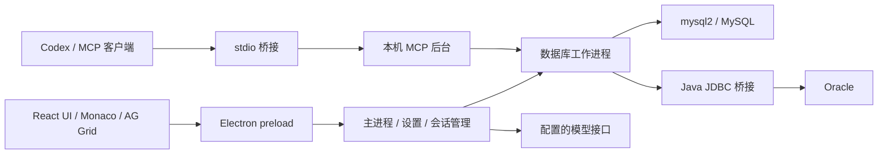

# 开发、验证与打包

## 1. 仓库内容与来源

本仓库把原始工程和当前安装版的维护材料一起保存，避免遗漏直接修改发布文件的后续工作。

| 目录 | 内容 | 当前定位 |
| --- | --- | --- |
| `src/` | React / TypeScript UI 和共享逻辑 | 原始 0.3.12 工程 |
| `electron/` | Electron 主进程、preload、worker、加密存储 | 原始 0.3.12 工程 |
| `java/QueryDeskBridge.java` | JDBC 进程桥接源码 | 原工程 |
| `java/QueryDeskBridge$Cursor.java` | JDBC 结果列类型补丁源码 | 当前安装版后续修改 |
| `runtime-snapshot/dist/` | 当前前端发布文件 | 从已验证安装版提取 |
| `runtime-snapshot/dist-electron/` | 当前 Electron 发布文件和新增模块 | 从已验证安装版提取 |
| `runtime-snapshot/manifest.json` | 发布代码 SHA256 与来源 ASAR 摘要 | 校验快照完整性 |
| `maintenance/patches/` | 产物补丁源码、可读 CJS 模块 | 后续修改的维护依据 |
| `maintenance/tests/` | 历次产物修改的隔离 UI / 协议测试 | 历史维护脚本 |
| `maintenance/installer/` | 本次安装目录再打包时的配置 | 历史打包参考 |
| `scripts/` | 开发、构建、运行时准备和快照组装 | 公开工程可用入口 |
| `tests/` | 原始 TypeScript 单元测试 | `npm test` |
| `runtime/manifest.json` | Java 和 JDBC 的固定下载地址及摘要 | 首次准备依赖 |
| `docs/` | 使用、MCP 和开发说明 | 当前公开文档 |

后续界面与后端修改尚未全部回移到 TypeScript 原文件。前端快照包含压缩后的编译产物和第三方库，**不是完整可读的 React 源文件替代品**。原工程源文件、后续补丁与当前执行代码都已保留，但不能宣称“直接重编译原 TypeScript 就能得到这次安装版”。

如果需要维护当前行为，先使用发布快照路线验证，再逐项把补丁回移到原始工程并补充对应测试。不要把 `maintenance/patches/` 中为旧安装目录编写的脚本无序执行在公开工程上：它们依赖特定旧文件、目录及压缩标识符，并非通用迁移器。

## 2. 开发环境

- Windows 10 / 11 x64。
- Node.js 22.12+ 或 24；项目使用 npm 与 `package-lock.json`。
- JDK 17 或 21，并能在终端运行 `javac`、`jar`。
- 首次安装依赖、下载 Java / JDBC 时需要联网。

成品安装用户无需这些开发工具。源码中的 JDBC 构建需要 JDK；运行时使用下载并打包的 JRE。

```powershell
node --version
npm --version
javac -version
jar --version
```

## 3. 获取工程与准备运行时

```powershell
git clone https://github.com/zjpCoder/QueryDesk.git
cd QueryDesk
npm ci
npm run setup:jdbc
```

`setup:jdbc` 根据 `runtime/manifest.json` 下载固定版本并核对 SHA256。下载的 JRE 在 `runtime/java/`，驱动在 `runtime/jdbc/`；这些是忽略目录，不作为 Git 源码提交。下载和编译临时文件保存在 `.cache/`。

## 4. 路线 A：运行本次安装版对应代码

```powershell
npm run verify:snapshot
npm run build:release
npm run start:release
```

- `verify:snapshot` 校验 22 个发布文件。
- `build:release` 编译 Java 桥接，复制当前发布快照到 `dist/` 和 `dist-electron/`，并重新编译结果列类型补丁。
- `start:release` 使用项目 Electron 启动当前发布代码，指向项目的 JDBC 运行时。

`build:release` 会重建项目根下的 `dist/`、`dist-electron/`，不修改 TypeScript 源文件和个人配置。因为运行的是同名应用，普通启动可能读取当前 Windows 用户已有的 QueryDesk 设置。希望使用隔离测试配置时，在启动前设置 `QUERYDESK_TEST_USER_DATA` 为一个单独目录。

```powershell
$env:QUERYDESK_TEST_USER_DATA = Join-Path $PWD '.cache\manual-test-profile'
npm run start:release
Remove-Item Env:QUERYDESK_TEST_USER_DATA
```

## 5. 路线 B：开发原始 TypeScript 工程

```powershell
npm run dev
```

`dev` 编译原始 Electron 源码并启动 Vite。原始工程包含 SQL、事务、AI、导出等主要功能，但不会自动获得所有后续产物补丁，例如新增主题、Codex 一键配置和新版表头 / 筛选工具栏。

```powershell
npm test
npm run build
npm start
```

`build` 运行 JDBC 构建、TypeScript 检查、Vite 构建和 esbuild。它会覆盖先前生成的发布快照目录；之后需要重新运行 `build:release`，才能再次得到当前安装版对应执行代码。

## 6. 打包 Windows 安装程序

### 打包当前发布代码

```powershell
npm run dist:release
```

### 打包原始工程

```powershell
npm run dist
```

安装包输出到 `release/`。两条路线共同使用 Electron Builder / NSIS，支持选择安装目录，并携带 Java 运行时与 JDBC 驱动。当前生产快照中使用的 MCP 桥接脚本会作为安装目录文件一起打包。

没有配置代码签名证书时不会产生受信任的发行者签名。项目没有自动更新服务；发布新安装包时在 GitHub Releases 提供下载及 SHA256。

当前公开安装包是从已验证的完整安装目录重新打包，Git 中的原始源码构建与快照组装路线也已分别说明。**Electron / NSIS 的压缩、时间戳和 Java 编译器可能使重新生成的安装包或 JAR 摘要不同**；快照摘要校验的是当前应用发布文件，不是保证所有机器输出同一安装包字节流。

## 7. 测试

```powershell
npm test
npm run verify:snapshot
npm run smoke:release
```

`smoke:release` 在 `build:release` 之后运行，使用隔离演示数据验证当前发布路线的启动、工具栏与排序。

原始工程还提供：

```powershell
npm run smoke
npm run smoke:oracle
```

`smoke` 使用隔离配置和本地协议夹具。`smoke:oracle` 需要自行提供 `QD_DB_HOST`、`QD_DB_PORT`、`QD_DB_USER`、`QD_DB_PASSWORD`、`QD_DB_SERVICE` 等环境变量；仓库没有测试库账号。真实库测试和本地夹具测试的证明范围不同。

`maintenance/tests/` 保存历次修改时使用的脚本，部分入口依赖当时安装目录和测试归档。它们不是统一的 `npm test` 测试集，不应默认指向生产数据库。

本次发布检查包括：

- 安装包解压后的 525 个文件与打包前运行目录逐项 SHA256 一致。
- 解压后的应用启动成功，筛选 / 排序 / 翻页 / 列头同步及窄窗口布局验证通过。
- 打包的 Java 运行时可以启动。
- 发布快照中 22 个文件有独立摘要清单。

这不等同于所有数据库版本、所有模型服务与所有写入场景的兼容性认证。

## 8. 架构概览



MCP 后台、普通 UI 标签和 AI 自动查询的权限入口不同。尤其不能把 AI 的固定只读工具解释为所有 MCP SQL 都只读；相关说明见 [MCP 文档](MCP.md)。

## 9. 公开发布时排除什么

`.gitignore` 排除依赖、JRE / JAR、构建输出、缓存、环境变量文件、日志、备份、设置和工作区。发布前仍需检查实际 Git 暂存清单。

安装程序放在 GitHub Release 附件，不提交到普通 Git 历史。源码归档不包含个人配置、数据库导出、测试报告或本机数据库连接。文档截图使用隔离演示数据。
